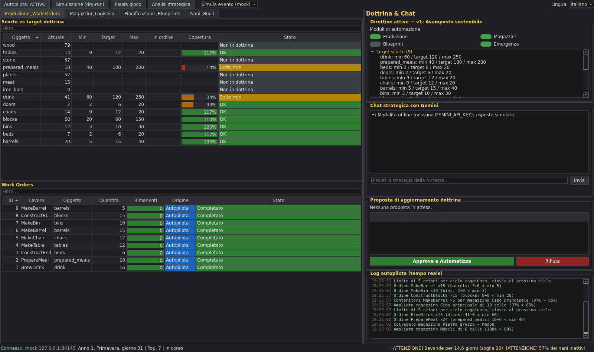

# Dwarf Doctrine Pilot

Co-pilota e autopilota *human-in-the-loop* per **Dwarf Fortress (Steam) + DFHack**, basato su una **Dottrina condivisa**.

| Ciclo | Chi | Costo token | Cosa fa |
|---|---|---|---|
| Strategico | Tu + Gemini (`gemini-2.5-flash`), **solo su richiesta** | < 2.000 token/chiamata | Discute la strategia e propone una patch della `FortressDoctrine`. Tu la approvi con **[Approva e Automatizza]** o la **[Rifiuti]**. |
| Operativo | Autopilota deterministico locale, ogni 5 s | 0 | Legge lo stato e applica la dottrina approvata: work order, magazzini, blueprint Quickfort nelle zone designate. |
| Emergenza | Regole locali | 0 | Ordini d'emergenza calcolati (giorni di cibo/bevande), poi **pausa del gioco e notifica a te**. Gemini **non** viene mai chiamato in automatico: solo se clicchi "Analizza con Gemini". |



## Avvio rapido

```bash
uv venv --python 3.11 .venv && source .venv/bin/activate   # oppure python3.11 -m venv .venv
pip install -e ".[dev]"
python main.py                       # GUI + fortezza simulata (mock) integrata
python main.py --lang en             # interfaccia in inglese (italiano predefinito)
python main.py --dry-run --speed 2   # pianifica senza eseguire, simulazione più veloce
```

Mock server separato (stesso protocollo JSON del futuro bridge DFHack):

```bash
python -m dfhack_bridge.mock_server --speed 0.5 --seed 7   # porta 5577
python main.py                                              # si collega al server se è attivo
```

Chat con Gemini: imposta `GEMINI_API_KEY` (o `GOOGLE_API_KEY`). Senza chiave la chat usa un advisor offline a parole chiave (birra, cibo, magazzini, difesa) per provare il flusso di approvazione.

| Variabile | Default | |
|---|---|---|
| `DDP_LANG` | `it` | `it` / `en` |
| `GEMINI_API_KEY` | — | chiave Gemini (Free Tier) |
| `DDP_GEMINI_MODEL` | `gemini-2.5-flash` | |
| `DDP_BRIDGE` | `mock` | `mock` / `dfhack` (stub nello Step 1) |
| `DDP_MOCK_PORT` | `5577` | |
| `DDP_DATA_DIR` | `./data` | dottrina approvata + storico versioni |

## Struttura

```
core/
  doctrine.py     schema Pydantic FortressDoctrine, DoctrinePatch, diff, storico approvazioni
  autopilot.py    motore deterministico: emergenza > produzione > magazzini > blueprint
  alarms.py       soglie cibo/bevande/stress/inattività/oggetti a terra/eventi critici
  advisor.py      Gemini (structured output, budget token e richieste) + advisor offline
  i18n.py         localizzazione IT (default) / EN
dfhack_bridge/
  base.py         interfaccia FortressBridge
  protocol.py     contratto dello stato (FortressState)
  mock_server.py  simulazione della fortezza nel tempo + server TCP JSON-lines
  mock_bridge.py  client TCP e bridge in-process
  dfhack_bridge.py + lua/   stub DFHack (comandi dfhack-run, script Lua da completare)
blueprints/       file Quickfort CSV + catalog.json (dimensioni, materiali, effetti)
ui/               GUI PySide6 stile Dwarf Therapist (QTableView + QAbstractTableModel)
tests/            pytest (dottrina, autopilota, mock server, advisor, GUI offscreen)
```

## Interfaccia

- **Produzione & Work Orders**: scorte vs target dottrina (copertura a barre, stato colorato), ordini con origine (autopilota / utente / emergenza).
- **Magazzini & Logistica**: riempimento %, oggetti a terra, link ai laboratori, regola di dottrina.
- **Pianificazione & Blueprints**: coda dottrina con precondizioni, stato (pianificato / bloccato / scavo / costruzione / completato), zone designate.
- **Nani & Ruoli**: griglia stile Therapist con stress, attività e livelli di abilità per mansione.
- **Pannello Dottrina & Chat**: direttive attive con switch ON/OFF per modulo, chat Gemini, diff della proposta con Approva/Rifiuta, log in tempo reale.

Barra superiore: autopilota ON/OFF, dry-run, pausa/riprendi, analisi strategica (chiamata Gemini esplicita), simulazione eventi (mock), lingua.

## Sicurezza del design

- L'autopilota esegue **solo** la dottrina approvata; ogni approvazione crea `data/history/doctrine_vNNNN.json`.
- Le patch di Gemini non possono toccare switch dei moduli, limiti o budget.
- Azioni idempotenti (tiene conto degli ordini in corso), massimo N azioni per ciclo (la pausa di sicurezza è sempre consentita).
- Cooldown per tipo di allarme: un allarme persistente mette in pausa una volta per finestra.
- Budget Free Tier lato client: richieste/minuto, richieste/giorno, cooldown per le analisi.

## Stato dello Step 1

- DFHack: solo interfaccia e stub (`dfhack_bridge/dfhack_bridge.py`, `dfhack_bridge/lua/`). Da completare e verificare in gioco.
- Il mock è un'approssimazione per sviluppare e dimostrare il flusso, non un modello fedele dell'economia di DF.
